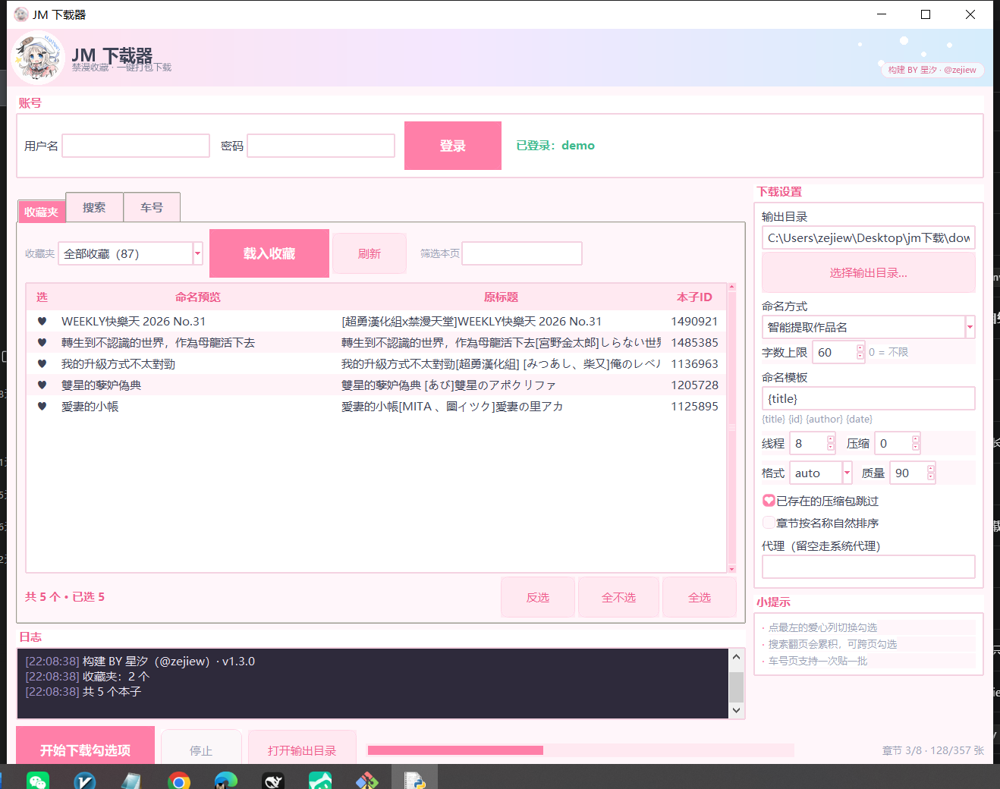

起因很没技术含量。收藏夹里堆了八十多个本子，每次想存下来，点进去、翻页、一张张右键、存到一个乱码文件夹里，再手动改成能认得出的名字。干过两回就不想干第三回了。

于是有了后面这堆事。

## 一开始只想写个脚本

第一版的想法就是"读收藏夹，遍历，下载，打包"。库是现成的，`jmcomic`，Python 里做这个最省事。

装完先跑了个连通性测试，确认能拿到数据。然后就顺理成章地用了它自带的 zip 插件——毕竟人家都写好了。

结果第一次实际跑完就发现不对劲：52 页的本子花了 25 秒，磁盘上还出现了又消失了一大堆中间文件。翻了下插件源码才明白，它的流程是「图片先落盘 → 全部下完 → 压缩 → 删掉原图」。等于每张图都要写一次盘、读一次、再写进 zip，三次 IO 干一件事。

那就自己写。反正下载回调里能拿到图片字节，直接塞进 zip 就行。改完之后中间文件没了，速度也上来了。

不用现成插件、自己接管写入，这是这个项目第一个真正意义上的决定。

## 快了一倍的那次改动

第一版写完，8 线程下大概 2.4 张/秒。我当时以为是网络慢，因为图片本身不小，一张 550KB 左右。

写了个脚本单独计时，拆开看：网络请求 0.15 秒，图片解码加重新编码 0.17 秒。差不多各占一半。网络这块没什么可优化的，图片都在这儿了。

但有个东西很奇怪。`jmcomic` 默认的传输实现是 `curl_cffi`，每个请求新建一个连接。图片有几十上百张，就是几十上百次 TLS 握手。换个复用连接的 `curl_cffi_session` 试试——

25.5 秒变成 12.9 秒。

就改了一个配置项。这个发现让我后面所有关于"慢"的判断都先怀疑连接层，而不是先怀疑带宽。

## 图片为什么必须重新编码

这是我最开始没想通的地方。

禁漫的图片是横向切片打乱过的，不解扰的话图是错的。这就意味着必须把它解成像素、重排、再编码回去。没法像普通爬虫那样 `response.content` 直接写文件。

既然避不开，就得选参数。攒了几个真实页面做对照，量了三件事：体积、耗时、和原图的差距（PSNR / SSIM）。

| 参数 | 体积 | 耗时/张 | PSNR |
|---|---|---|---|
| webp q85 | 122% | 139ms | 42.3dB |
| webp q90 | 131% | 159ms | 44.9dB |
| webp q95 | 153% | 168ms | 48.4dB |
| jpeg q92 | 172% | 12ms | 43.1dB |
| webp 无损 | 245% | 1288ms | 99dB |

体积那一列不是笔误——重编码出来的文件比原图还大。因为原图是站点压过的，我这边再压一次反而膨胀。

最后默认选了 `webp q90`。45dB 这个量级肉眼已经分不出来，体积只大一档。想极致速度就切 `jpeg`，快十倍，体积大些。

顺手做了个判断：如果某张图本来就不需要解扰（老本子），直接存原始字节，零成本。实测抽了 30 张，全都需要解扰，这条优化其实没怎么用上。留着不亏就是了。

## 最花时间的部分：文件名叫什么

按理说 `album.title` 就是标题，直接拿来当文件名就完了。

问题是这玩意长这样：

```
[無邪氣漢化組] (C99) [紺色果實 (紺菓)] サレンの樂しい夢 (プリンセスコネクト!Re:Dive) [中國翻譯] [無修正]
```

真正能指代作品的只有中间那段。前后那些是汉化组、作者、原作出处、语言、版本，全都跟"这是哪个本子"没关系。

我一开始想用正则，写着写着发现规则会越堆越多，而且互相打架。停下来换了个思路：先抓真实样本。

搜了八个关键词，收了 603 条真标题，统计了一下括号里都出现些什么。`[中國翻譯]` 出现 227 次，`[DL版]` 105 次，`[AI Generated]` 35 次……这些就是噪声，一眼能认出来。

然后定了这么一条规则：

1. 按括号切成若干段
2. 从第一个非括号、且不是纯元数据的段开始（前面全是汉化组/作者，跳过）
3. 往后只接紧贴的段，中间有空格就停
4. 噪声括号跳过但不打断，圆括号保留——那是原作出处，有用
5. 一遇空格就停，空格后面基本都是另一种语言的重复
6. 剩下的按 `/` `|` 切多语言版本，取中文字符最多的那个

跑完 603 条，平均收敛到 16.6 字，没有一条被洗空。

典型的几个：

| 原标题 | 提取结果 |
|---|---|
| `[超勇漢化組×禁漫天堂](C108)[ぽんぽこ]生徒會の秘密[中國翻譯]` | `生徒會の秘密` |
| `老師的秘密 1[乃希漢化] [大地巧太]先生の秘密 その1` | `老師的秘密 1` |
| `下班後的例行戀愛/下班後的秘密關係` | `下班後的例行戀愛` |
| `[純純的個人翻譯] [Anamimai] Jingwei Secret \| 靜微的秘密 [Chinese]` | `靜微的秘密` |

规则里"紧贴"这个词是关键。因为噪声括号删掉之后，作品名和后面的元数据之间往往没有空格，而和另一种语言之间一定有空格。这个规律在样本里几乎没例外。

## 关于界面，一个不太显然的选择

命令行版本做完，用起来是够了。但要发给别人的话，命令行不行。

我选了 tkinter。不是因为它好——它其实相当难用，控件样式老旧，很多效果要自己画。选它是因为不用额外依赖，Python 自带，打包出来的 exe 不会因为少个运行时库在别人电脑上崩掉。

代价是样式全得自己来：

- ttk 原生按钮是方角，要做圆角得用 PIL 画一张 9-patch 贴图塞给 `style.element_create`
- 默认勾选框是"黑底白叉"，太扎眼，画了张粉色爱心替换
- 主题色集中在一个 `theme.py` 里，改一处全局生效

界面长这样：



## 打包时踩的坑

PyInstaller 打出来 26MB 单文件，能跑。但踩了几个坑。

**延迟导入的模块它看不见。** `Crypto.Cipher.AES` 是在函数内部 import 的，静态分析扫不到。第一版打出来一联网就崩。得在 `--hidden-import` 里一个个点名。

**启动那三秒是空的。** 单文件 exe 运行时要先把自己解压到临时目录，实测 3.55 秒才出第一个窗口。这期间用户什么都看不见，很容易以为没反应又点一次。

先试了自己画个 Tk 启动窗，结果不显示——它在解压之后才执行，正好错过了需要它的时候。换成 PyInstaller 的 `--splash`，这个由 bootloader 负责，1.58 秒就出来了。

**命令行版中文乱码。** Windows 控制台默认 GBK，中文全变方块。得手动 `SetConsoleOutputCP(65001)`。

最后加了图标、版本信息、启动图，还有个一键打包脚本 `build.py`。

## 后来加的搜索和车号

发布之后自己用着用着，发现收藏夹不是唯一入口。

有时候是在别处看到推荐，想下某本，但懒得先去收藏再回来下载。于是加了车号页，粘贴 `123456` / `JM123456` / 网址都行，还能一次贴一批。

有时候是想找某个题材，于是加了搜索页，接站内搜索，能按最新/最热排序、按分类筛。翻页结果会累积，可以跨页勾完再一起下。

三个入口做成三个标签页，共用同一套勾选和下载逻辑。列表里除了原标题，还多了一列命名预览——就是它落盘时会用的文件名。不满意可以当场切模式。

## 修过的几个真实 bug

写代码不难，难的是发现哪里错了。

**登录报 `KeyError: 'update'`。** `option.auth` 是个 `AdvancedDict`，它的 `__getattr__` 会把 `.update()` 当 key 去查，于是炸了。改成逐键赋值。

这个 bug 挺阴的——之前所有测试用的都是 `login_with_cookies`，正好绕开了这条路径，所以一直没暴露。等真正打包测试才发现。后来专门加了 `test_login.py`，里面有一条还断言".update() 会炸"，防止以后有人顺手优化回去。

**窗口被压窄。** 布局逻辑里写的是"只要有一边不够，就把宽高一起重设"，结果 1280 宽的窗口被压成 1103。改成只补不够的那一边。

**字形缺失。** 界面上那些装饰符号 `✿ ⌕ ☰` 在微软雅黑里没有，显示成方框。写了个脚本比对 notdef 逐字验证，最后只留下确实存在的。

## v1.3.1：两个用户报上来的 bug

**搜索翻不到第二页。** 用户说作者页超过一页时，点"下一页"没反应。翻了下代码，`_page_search` 先算出目标页 `self._search_page = target`，然后调 `_do_search(reset=True)`——而 `_do_search` 里头第一件事就是 `if reset: self._search_page = 1`。于是刚算好的页码当场被冲掉，请求的永远是第 1 页。状态栏显示"第 2/30 页"，列表却还是第一页的内容，看起来就像点击无效。

修法是把"页码"和"替换还是追加"从 `reset` 这一个布尔里拆出来：`_do_search(reset, page, append)`，翻页走 `reset=False, page=target, append=True`。顺手加了 `_searching` 闸门——搜索在途时再点下一页直接忽略，否则连点会并发发请求、回来顺序一乱，追加就重了。

这类 bug 的教训是：一个布尔量同时表达"重置页码"和"替换列表"两件事，迟早会有人只想要其中一半。

**自动命名加上作者。** 以前只留作品名，作者被当噪声一起丢了。现在从本子详情的 `authors` 取作者，以 `[作者] 作品名` 的形式拼回去。几个坑：

- 有的标题里本来就写了作者（`[紺菓] 紺菓的作品`），再加一遍变成 `[紺菓] 紺菓的作品`，所以要先查作品名里有没有这个作者
- jmcomic 在没有作者信息时返回占位值 `default_author`，直接写进文件名很难看，得过滤掉
- 模板里可能已经写了 `{author}`，那就别再自动加前缀
- 字数上限应该只管作品名，不能因为加了作者就把作品名截得更短

列表里那列"命名预览"也同步改了，用的是和落盘时同一套规则——预览和实际文件名对不上是最容易让人困惑的。

## 现在的样子

最终的形态：

- 三个入口：收藏夹、搜索、车号
- 智能命名：从长标题里提取作品名，603 条实测平均 16.6 字
- 速度：52 页约 7 张/秒（12 线程）
- 零依赖运行：打包成 26MB 单文件 exe，双击即用

界面是樱粉加天空蓝的配色，顶部横幅带作者角标，启动页有深色 splash：


代码规模：`jmfav/` 下 10 个模块共约 3600 行，29 个测试脚本，`python tests/run_all.py --live` 跑完整套（含 6 组真实联网下载）大约两分钟。

## 几句不好听的

这东西的价值不大，本质是把自己讨厌的手工活自动化了。但过程中确实碰到了几个值得记的点。

**先测量再优化。** 我一开始以为是网络慢，拆开一看网络只占一半，真正的大头是连接复用。如果直接去调线程数，调到 24 也还是那个速度。

**数据比直觉可靠。** 提取标题这事，我凭感觉写正则写到第四版还是不对，抓了 600 条样本统计完，规则一下就清楚了。后来验证参数、验证解码正确性也是同样的路数。

**打包是独立的一关。** 开发环境能跑不代表 exe 能跑。隐藏依赖、启动速度、编码问题，都是打包才暴露的。

**测试要覆盖真实路径。** 那个登录 bug 就是因为测试绕开了主路径。现在有几组测试是会真的去下载的，慢一点，但能兜住这类问题。

---

项目开源在 [github.com/zejiew/JMCOMIC-DP](https://github.com/zejiew/JMCOMIC-DP)。

构建 BY 星汐（zejiew）
