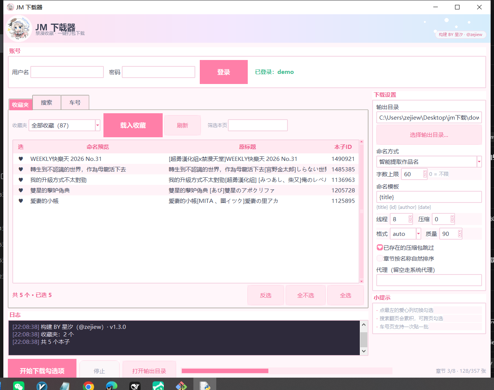

# JM 下载器

把禁漫 JM 的漫画批量下载成 zip 压缩包。三个入口随便用：

- **收藏夹** —— 一次勾选整本收藏，批量下
- **搜索** —— 站内搜索，边看边勾
- **车号** —— 粘贴 ID 或链接，直接点名要哪一本

压缩包自动用**作品名**命名：从 `[漢化組][作者] 作品名 (出處) [語言] [版本]` 这种长标题里
剥出真正能指代作品的那一段，噪声一律丢掉。

界面是樱粉 + 天空蓝的二次元风格：



> 仅供个人备份自己已收藏、有权访问的内容使用。请遵守当地法律与站点条款。

---

## 作者

**星汐（zejiew）** —— 构建 BY 星汐

作者信息集中定义在 [jmfav/theme.py](jmfav/theme.py) 顶部，改一处即可全站生效：

```python
AUTHOR = '星汐'
AUTHOR_ID = 'zejiew'
CREDIT = f'构建 BY {AUTHOR}'
CREDIT_LONG = f'构建 BY {AUTHOR} · @{AUTHOR_ID}'
```

出现的位置：

| 位置 | 显示 |
|---|---|
| 顶部横幅右下角 | `构建 BY 星汐 · @zejiew`（窗口窄于 900px 时只显示 `构建 BY 星汐`） |
| 启动页右下角 | 橙色胶囊水印 `构建 BY 星汐 @zejiew` |
| 日志首行 | `构建 BY 星汐（@zejiew）· v1.3.0` |
| `使用说明.txt` 底部 | `构建 BY 星汐（zejiew）` |

---

## 快速开始

### 方式一：直接跑 exe（推荐，别人拿到也能用）

从 `release/JM下载器-v1.3.0-win64.zip` 解压出来，双击 **`JM下载器.exe`**。
不需要装 Python、不需要装任何依赖。

- `JM下载器.exe` —— 图形界面
- `jmfav-cli.exe` —— 命令行版
- `使用说明.txt` —— 给最终用户看的简易说明

启动时会先显示一个深色的启动图（DP / JMCOMIC logo），盖住单文件 exe 解压自身的那一两秒。

### 方式二：源码运行

双击 `安装.bat` 装依赖，然后双击 `启动.vbs`（无控制台窗口）或 `启动.bat`。

### 自己重新打包

```bat
python build.py              :: 单文件 exe（默认）
python build.py --onedir     :: 打包成文件夹，启动更快
python build.py --console    :: 保留控制台，排查问题用
python make_release.py       :: 打成可直接发出去的 zip
```

产物在 `dist/`，发布包在 `release/`。需要 `pip install pyinstaller`。

---

## 界面说明

色调走「樱粉 + 天空蓝 + 淡紫」：浅粉底、白卡片、粉色主按钮，日志区用深紫做对比。

| 区域 | 说明 |
|---|---|
| 顶部横幅 | 渐变底 + Q 版头像 + 标题，随窗口宽度自动重绘 |
| 账号 | 白卡片，粉色「登录」主按钮，右侧显示登录状态 |
| 标签页 | 收藏夹 / 搜索 / 车号，选中的页是实心粉底白字 |
| 列表 | 白色行 + 浅粉隔行，第一列是爱心勾选框（♥ 已选 / ♡ 未选） |
| 右栏 | 下载设置，窗口矮时可滚动（装得下时滚动条自动收起） |
| 小提示 | 右下角常驻的几条操作提示 |
| 日志 | 深紫底，时间戳淡紫、完成绿色、失败粉色、命名橙色 |
| 底部 | 进度条 + 开始/停止/打开目录，始终固定在底部不会被挤掉 |

配色与字体集中在 `jmfav/theme.py`，改一处就全局生效。

素材放在 `assets/`：

- `icon_src.jpg` —— 运行时图标（Q 版立绘），会抠成圆形头像 + 粉色细环做成 `icon.ico`
- `logo_src.jpg` —— 启动 logo（DP / JMCOMIC），用来生成启动图 `splash.png`

```bat
python make_icon.py     :: 重新生成 icon.ico
python make_splash.py   :: 重新生成 splash.png
```

---

## 三个标签页

### 收藏夹

```
[全部收藏(87) ▾] [载入收藏] [刷新]  筛选本页 [____]
```

选好收藏夹点「载入收藏」，整本收藏会一次性列出来。多个收藏夹可以逐个拉，
列表是**累加**的（切收藏夹不会清掉已经载入的）。

### 搜索

```
[关键词________] [搜索]        关键词填车号也能直达
排序 [最新▾]  分类 [全部▾]
                          ◂ 上一页  共 2342 条 · 第 1/30 页  下一页 ▸
```

- 排序：最新 / 最热 / 最多图 / 最多喜欢
- 分类：全部 / 同人 / 单本 / 短篇 / 韩漫 / 美漫 / 其他
- 每页 80 条；翻页是**追加**，可以在多页里跨页勾选后再统一下载
- 关键词直接填车号（如 `123456`）会命中「车号直达」，直接给你那一本

### 车号

```
车号 / 链接 [____________________] [添加] [清空]
[直接下载这个 ID]  支持 123456 / JM123456 / 网址；多个用逗号或空格隔开
```

支持的写法：

```
123456
JM123456        jm123456        JM 123456      JM-123456
[123456]        【123456】       (123456)
https://18comic.vip/album/123456/
https://www.cdngwc.cc/album?id=123456
https://18comic.org/comic/123456
https://18comic.vip/photo/987654      ← 章节链接也行
```

一次贴一批：

```
123456, 789012 333333
https://18comic.vip/album/444444/ 555555
```

添加后会在后台自动补全标题（列表里从 `JM123456` 变成真正的作品名）。
「直接下载这个 ID」是省事版：填一个、点一下，立刻开下。

---

## 命名：只留作品名

这是这个工具最花心思的地方。禁漫的标题往往长这样：

```
[無邪氣漢化組] (C99) [紺色果實 (紺菓)] サレンの樂しい夢 (プリンセスコネクト!Re:Dive) [中國翻譯] [無修正]
```

真正有用的是 `サレンの樂しい夢 (プリンセスコネクト!Re:Dive)`，其余都是噪声。

### 规则

1. 按括号切成若干段
2. 从**第一个非括号、且不是纯元数据**的段开始（前面的 `[漢化組]` `[作者]` 全跳过）
3. 向后只接**紧贴**的段：
   - 噪声括号（`[中國翻譯]` `[DL版]` `[AI Generated]`…）跳过但不打断
   - 圆括号（原作出处，如 `(ブルーアーカイブ)`）保留
   - 一遇空格就停（空格之后基本是另一种语言的重复、作者、汉化组）
4. 再紧贴的**方括号**一律当元数据，停
5. 剩下的按 `/` `|` 切多语言变体，取中文字符最多的
6. 清掉尾部残留括号与点缀符

### 效果

| 原标题 | 存成 |
|---|---|
| `[無邪氣漢化組] (C99) [紺色果實] サレンの樂しい夢 (プリコネ) [中國翻譯] [無修正]` | `サレンの樂しい夢 (プリコネ)` |
| `[超勇漢化組×禁漫天堂](C108)[ぽんぽこ(たたきた)]生徒會の秘密[中國翻譯]` | `生徒會の秘密` |
| `[山嵐個人漢化] [くろねこ (NTR専門)] 【NTR】誰にも言えない秘密` | `誰にも言えない秘密` |
| `老師的秘密 1[乃希漢化] [大地巧太]先生の秘密 その1` | `老師的秘密 1` |
| `下班後的例行戀愛/下班後的秘密關係` | `下班後的例行戀愛` |
| `秘密教學 / 秘密の授業` | `秘密教學` |
| `[純純的個人翻譯] [Anamimai] Jingwei Secret \| 靜微的秘密 [Chinese]` | `靜微的秘密` |
| `[goodkids (AK1)] 海風の秘密 (ハンター×ハンター) [中國翻譯]` | `海風の秘密 (ハンター×ハンター)` |
| `[牧部かたる]人妻女教師的秘密的課外授業` | `人妻女教師的秘密的課外授業` |
| `[AB] 某作品 [Chinese] [Digital] [作者]` | `某作品` |

实测 603 条真实标题：**平均 16.6 字**，没有被洗空的，超 45 字的只有 11 条
（那些标题本身就是一整句话的作品名）。

### 两种模式

| 模式 | 说明 |
|---|---|
| **智能提取作品名**（默认） | 只留作品名，去掉汉化组/作者/语言 |
| **完整原标题** | 原样用整条标题 |

列表第二列「命名预览」会实时显示**它落盘时会用的文件名**，换模式立刻能看到区别。
改「标题最多字数」时预览也跟着变。

### 还有两道保险

- 超过「标题最多字数」（默认 60）就**直接截断到该字数**，不加省略号
- Windows 不允许的 `<>:"/\|?*` 换成全角同形字（`＜＞：＂／＼｜？＊`），比下划线好认
- 整条路径超 240 字符会再收一次，防 Windows 长路径报错
- 同名不覆盖：已存在且开了「跳过」就跳过，关了就自动加 ` (2)`

---

## 右栏设置

| 选项 | 说明 |
|---|---|
| **输出目录** | zip 存到哪。默认程序目录下的 `downloads` |
| **命名方式** | 智能提取作品名 / 完整原标题 |
| **标题最多字数** | 超过即截断，默认 60。`0` = 不限 |
| **命名模板** | 默认 `{title}`。可用 `{title} {id} {author} {date}`，如 `[{id}] {title}` |
| **图片线程** | 并行下载数，默认 8。网快可调 12–16 |
| **压缩** | zip 压缩级别。图片本身已压缩，**默认 0（只打包，最快）** |
| **图片格式** | `auto` 跟随原图；`webp` 体积小；`jpeg` 最快；`png` 无损但大 |
| **质量** | 重编码质量，默认 90（PSNR 约 45dB，肉眼无差） |
| **已存在的压缩包跳过** | 建议开。重跑只下新的 |
| **章节按名称自然排序** | 让「第 2 话」排在「第 10 话」前 |
| **代理** | 形如 `http://127.0.0.1:7890`。留空走系统代理 |

### 列表操作

- 点**「选」列**切换勾选；点其它列只是选中行（不会误取消）
- 空格键切换选中行；`Ctrl+A` 全选
- 双击打开网页；右键有「仅选这一本 / 复制标题 / 复制作品名 / 复制 ID」

---

## 命令行

双击 `命令行.bat`，或终端里 `python run.py --cli ...`。

```bat
:: 收藏夹（默认行为）
python run.py --cli -u 用户 -p 密码 -l 20 --max-chars 40

:: 搜索并下载前两页
python run.py --cli -u 用户 -p 密码 --search 秘密 --search-pages 2
python run.py --cli -u 用户 -p 密码 -s 老師 --sort hot --category doujin

:: 车号（单个 / 一批 / 粘贴链接）
python run.py --cli -u 用户 -p 密码 --id 123456
python run.py --cli -u 用户 -p 密码 --ids 123456 789012 https://18comic.vip/album/555555/

:: 用完整原标题命名
python run.py --cli -u 用户 -p 密码 --ids 123456 --name-mode full

:: 先看看会下什么、叫什么名字（不真下）
python run.py --cli -u 用户 -p 密码 --search 秘密 --dry-run

:: 只看收藏夹列表
python run.py --cli -u 用户 -p 密码 --list-folders
```

完整参数：`python run.py --cli -h`

---

## 常见问题

**登录失败？**
先在浏览器确认账号能登。程序走移动端 API，通常不受网页验证码影响；
登录成功后 cookies 会存进 `config.json`，下次自动复用。

**下载很慢？**
瓶颈一般不在网络，而在图片解密后的重编码（每张约 130–170ms）。
提速办法：「图片格式」改成 `jpeg`（快约 10 倍，体积大些），或「图片线程」调到 12–16。

**报「未登录或登录已失效」？** 点一次「登录」刷新 cookies。

**下载到一半关了程序？** 未完成的包是 `xxx.zip.part`，不污染结果目录；下次重跑会跳过已完成的。

**搜索到的条目太多？** 换更精确的词，或加「分类」限定。翻页会追加，可以在多页里勾选。

**车号页看到标题是 `JM123456`？** 后台正在补全，稍等一下就会变成真名；
补全失败也能下（只是命名会用 `JM<id>`）。

**压缩包里图片顺序对不对？** 对的。下载是并行抓的，写入 zip 时严格按页码顺序。

### 压缩包内部结构

- **单话本子** → 图片直接在根目录：`00001.webp`、`00002.webp`…
- **多话本子** → 每话一个子文件夹：`001 第1话/00001.webp`…

---

## 文件说明

### 给最终用户（打包版里就这几个）

| 文件 | 作用 |
|---|---|
| `JM下载器.exe` | 图形界面，双击即用 |
| `jmfav-cli.exe` | 命令行版 |
| `使用说明.txt` | 简易说明 |

### 源码

| 文件 | 作用 |
|---|---|
| `build.py` | 打 exe（含图标、启动图、素材、隐藏依赖声明） |
| `make_release.py` | 把 dist 打成发布 zip |
| `make_icon.py` / `make_splash.py` | 从 assets 里的图生成图标与启动图 |
| `make_version.py` | 生成 exe 的版本信息资源 |
| `pack_entry.py` / `pack_cli.py` | 两个 exe 的打包入口 |
| `assets/` | 图标与 logo 原图 |
| `docs/screenshot.png` | 界面截图 |
| `启动.vbs` / `启动.bat` | 源码方式启动图形界面 |
| `命令行.bat` | 源码方式命令行 |
| `安装.bat` | 首次装依赖 |
| `run.py` | 源码入口（自动使用 `.venv` 里的 Python） |
| `jmfav/theme.py` | **配色、字体、ttk 样式、自绘勾选框、顶部横幅** |
| `jmfav/title.py` | **从长标题提取作品名** |
| `jmfav/ids.py` | 车号/链接解析 |
| `jmfav/naming.py` | 截断、非法字符、路径限长 |
| `jmfav/codec.py` | 图片解密与重编码 |
| `jmfav/engine.py` | 登录、收藏夹、搜索、下载打包 |
| `jmfav/gui.py` | 图形界面（三个标签页） |
| `jmfav/cli.py` | 命令行 |
| `jmfav/paths.py` | 配置与输出目录选择（含只读目录降级） |
| `config.json` | 自动生成：账号名、cookies、各项设置 |
| `tests/` | `python tests/run_all.py [--live]` |

